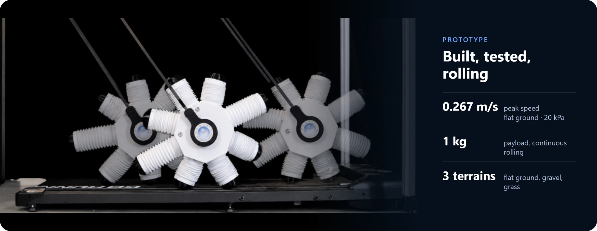
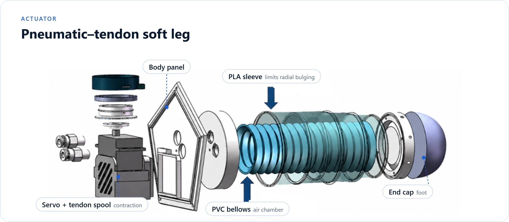
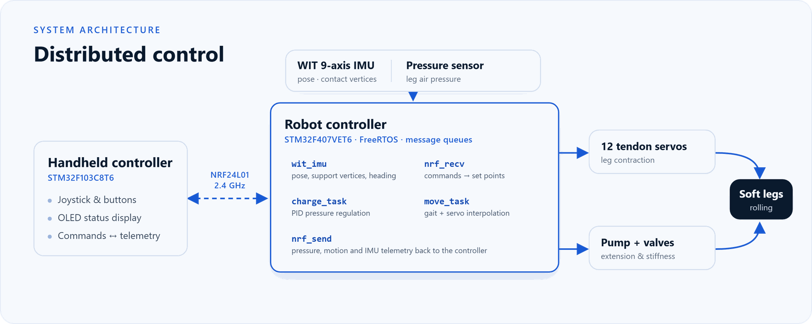
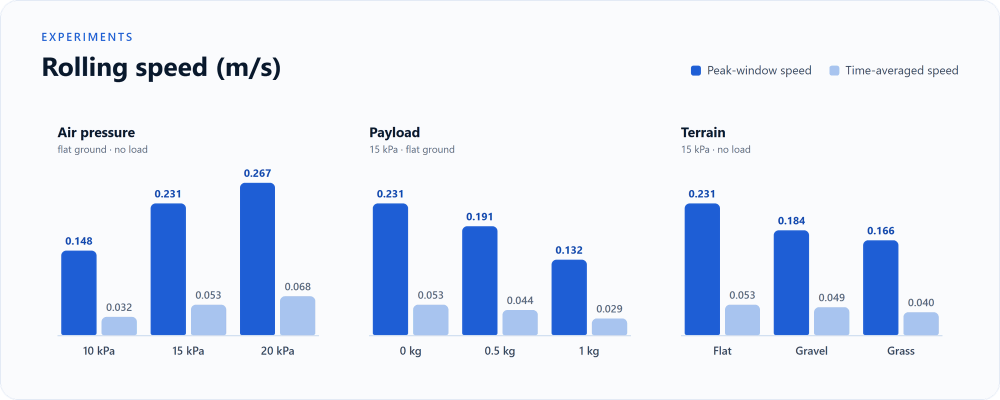

<div align="center">


<br />

**English** · [简体中文](README.zh-CN.md)


</div>

Twelve soft legs sit on the faces of a dodecahedron. Contracting two and extending one pushes the center of mass past the support edge, so the robot tips over onto its next face — and keeps rolling, in any direction, with no external air line.



## How it works



- **Tendon** — a servo winds a tendon to pull the leg in.
- **Air** — a bellows inside a PLA sleeve pushes the leg out and sets its stiffness.
- **Coupled circuit** — legs share air, so the two contracting legs feed the extending one (≈34% less tendon tension, ≈3× extension force).



## Results



<sub>Peak-window speed averages the speed peaks of each rolling cycle; time-averaged speed includes the pauses between cycles. Measured on the original prototype.</sub>

## Repository

```text
firmware/
├── robot/        STM32F407VET6 · Keil project, FreeRTOS tasks (Task/), drivers (Hardware/)
├── controller/   STM32F103C8T6 · handheld remote with OLED
└── prebuilt/     ready-to-flash .hex images
hardware/cad/     SolidWorks parts & assemblies, STL / 3MF
```

## Quick start

- **Flash** — write [`firmware/prebuilt/rolling-robot.hex`](firmware/prebuilt/rolling-robot.hex) (robot) and [`controller.hex`](firmware/prebuilt/controller.hex) (remote) with STM32CubeProgrammer.
- **Build** — open [`RollingRobot.uvprojx`](firmware/robot/MDK-ARM/RollingRobot.uvprojx) or [`Controller.uvprojx`](firmware/controller/MDK-ARM/Controller.uvprojx) in Keil MDK-ARM (STM32F1/F4 packs).
- **Print** — STL / 3MF files are in [`hardware/cad/`](hardware/cad/); see the [mechanical notes](hardware/README.md).

More: [firmware notes](firmware/README.md). This is a research prototype — a full BOM and wiring diagram are not included yet.

## About

B.Eng. capstone by **Yufeng Zeng**, School of Robotics, South China University of Technology · Advisor: Prof. Yunquan Li.
The pneumatic–tendon coupling builds on Fu et al., *IEEE Robotics and Automation Letters*, 2024.

No open-source license yet; reuse requires the author's permission.
