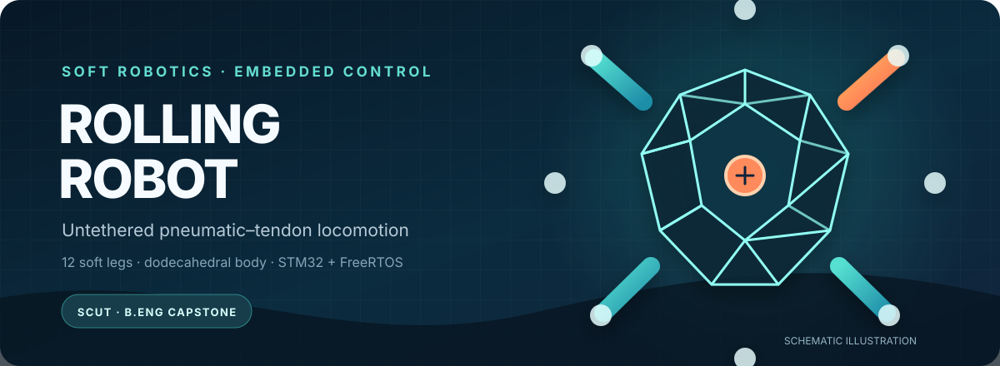
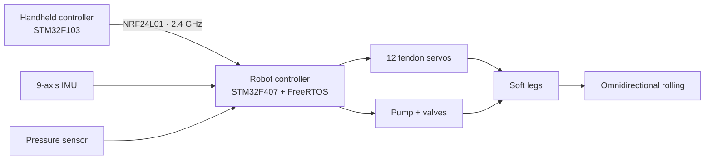

<div align="center">



# Rolling Robot

**An untethered dodecahedral soft robot that rolls by reshaping itself.**

[English](README.md) · [简体中文](README.zh-CN.md)


</div>

---

Twelve pneumatic–tendon soft legs sit on the faces of a regular dodecahedron. By contracting and extending them in sequence, the robot pushes its center of mass past the support polygon and rolls in any direction — with no external air line.

B.Eng. capstone project · School of Robotics, South China University of Technology · Advisor: Prof. Yunquan Li

## Highlights

- **Omnidirectional rolling** — 12 actuated faces on a symmetric dodecahedral body
- **Pneumatic–tendon coupled legs** — tendons contract, air pressure tunes stiffness and extension force
- **Interconnected air circuit** — air displaced by two contracting legs is reused by the extending one
- **Distributed control** — handheld STM32F103 controller + on-board STM32F407 running FreeRTOS
- **IMU state estimation** — detects the supporting vertices and picks the next rolling direction

## Results

| Metric | Value |
| --- | --- |
| Peak-window speed (flat ground, 15 kPa) | **0.267 m/s** |
| Full-run average speed (15 kPa) | 0.053 m/s |
| Payload | Rolls continuously with **1 kg** (−43% speed) |
| Terrain | Flat ground, gravel, grass |
| Coupled vs. uncoupled actuation | ~34% lower tendon tension, ~3× extension force |

<sub>Measured on the original prototype; not a performance guarantee for reproductions.</sub>

## System architecture



On the robot, five FreeRTOS tasks communicate through queues:

| Task | Source | Role |
| --- | --- | --- |
| `wit_imu` | [`wit_imu.c`](firmware/robot/Task/Src/wit_imu.c) | Attitude, supporting vertices, direction and speed |
| `nrf_recv` | [`nrf_recv.c`](firmware/robot/Task/Src/nrf_recv.c) | Receives commands, updates set points |
| `charge_task` | [`pump_charge.c`](firmware/robot/Task/Src/pump_charge.c) | Pressure control with PID-assisted soft PWM |
| `move_task` | [`servo_move.c`](firmware/robot/Task/Src/servo_move.c) | Gait selection and interpolated servo motion |
| `nrf_send` | [`nrf_send.c`](firmware/robot/Task/Src/nrf_send.c) | Telemetry back to the controller |

## Repository layout

```text
Rolling_Robot/
├── firmware/
│   ├── robot/        # STM32F407VET6 · Keil project, FreeRTOS tasks, drivers
│   ├── controller/   # STM32F103C8T6 · handheld remote with OLED
│   └── prebuilt/     # Ready-to-flash .hex images
├── hardware/
│   └── cad/          # SolidWorks parts & assemblies, STL / 3MF exports
└── docs/assets/      # README artwork
```

## Getting started

**Flash prebuilt firmware** — use STM32CubeProgrammer (or any ST-Link tool):

| File | Target |
| --- | --- |
| [`firmware/prebuilt/rolling-robot.hex`](firmware/prebuilt/rolling-robot.hex) | STM32F407VET6 robot controller |
| [`firmware/prebuilt/controller.hex`](firmware/prebuilt/controller.hex) | STM32F103C8T6 handheld controller |

**Build from source** — install Keil MDK-ARM with the STM32F1/F4 device packs, then open:

- Robot: [`firmware/robot/MDK-ARM/RollingRobot.uvprojx`](firmware/robot/MDK-ARM/RollingRobot.uvprojx)
- Controller: [`firmware/controller/MDK-ARM/Controller.uvprojx`](firmware/controller/MDK-ARM/Controller.uvprojx)

Pin assignments live in each project's `.ioc` file. Generated HAL/CMSIS sources are committed so the projects open without regenerating them in STM32CubeMX.

More details: [firmware notes](firmware/README.md) · [mechanical notes](hardware/README.md)

## Prototype specifications

| Parameter | Value |
| --- | --- |
| Body | Regular dodecahedron, 150 mm circumscribed radius |
| Legs | 12 × pneumatic–tendon soft legs, 75 mm nominal travel |
| Robot MCU | STM32F407VET6 (Cortex-M4, 168 MHz) |
| Controller MCU | STM32F103C8T6 (Cortex-M3) |
| Wireless | NRF24L01, 2.4 GHz |
| Sensing | WIT 9-axis IMU, pressure sensor |
| Software | STM32 HAL + FreeRTOS |

## Scope

This is an archived research prototype, not a plug-and-play kit. Reproducing it requires matching electronics, pneumatic parts, servo calibration and assembly. A full BOM and wiring diagram are not yet included.

## Acknowledgment

The pneumatic–tendon coupling concept builds on prior work by Fu et al. on untethered soft rolling robots (*IEEE Robotics and Automation Letters*, 2024).

## License

No open-source license yet — copyright remains with the author (Yufeng Zeng) and reuse requires permission.
