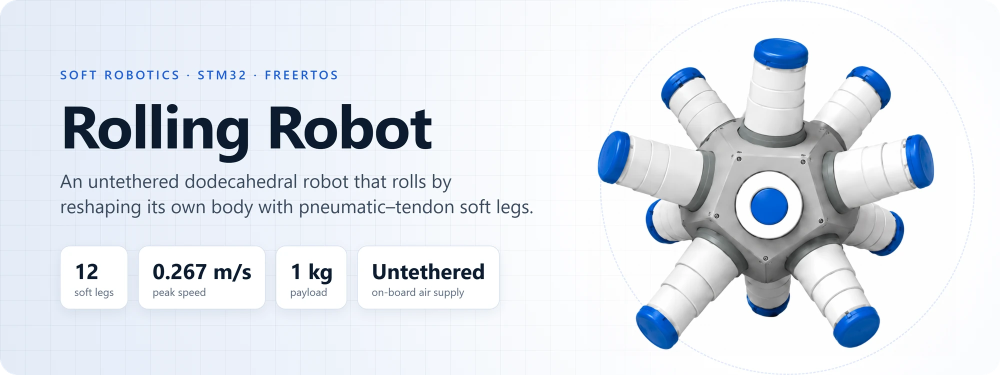
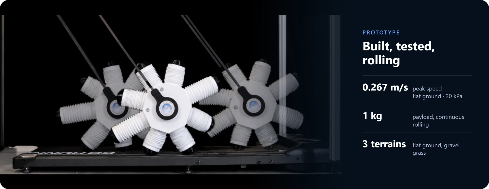
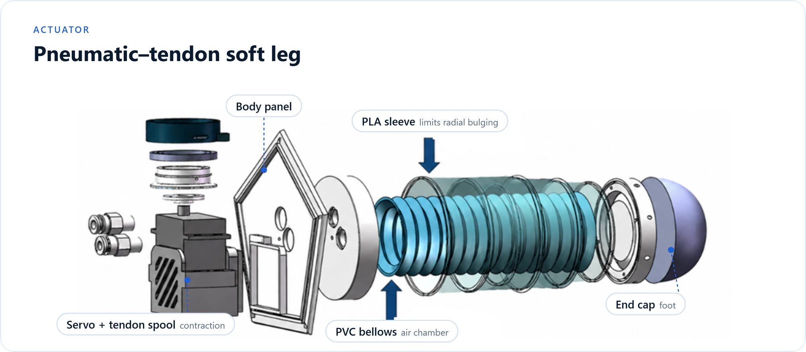
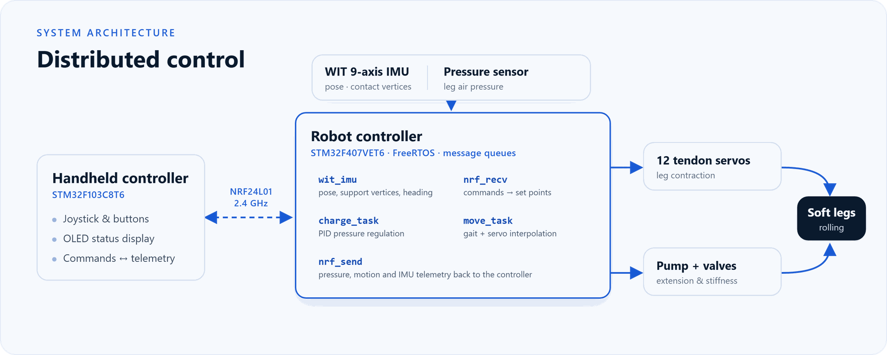
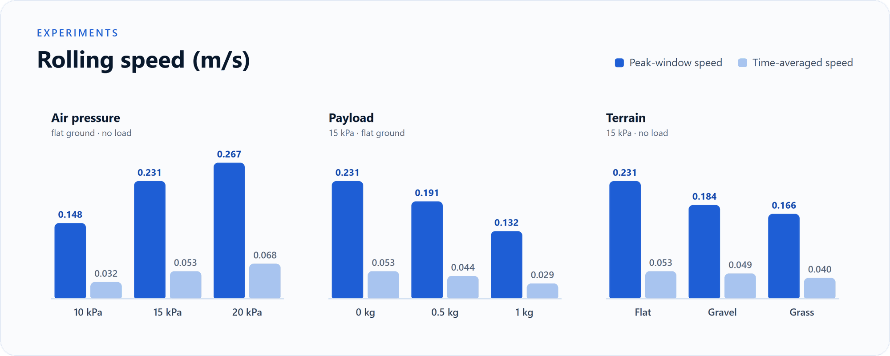

<div align="center">



<br />

[English](README.md) · **简体中文**


</div>

12 条软腿分布在正十二面体的各个面上。两腿收缩、一腿伸展，把重心推过支撑边，机器人便翻到下一个面——如此循环，即可向任意方向滚动，且无需外接气管。



## 工作原理



- **腱驱**：舵机收线，把软腿拉短。
- **气动**：PLA 套筒内的波纹管充气，把软腿推长并调节刚度。
- **互联气路**：两条收缩腿挤出的气体直接供给伸展腿（腱绳张力降低约 34%，伸展力提升近 3 倍）。



## 实验结果



<sub>窗口峰值速度为各翻滚周期速度峰值的平均；时间平均速度包含周期间的等待时间。数据来自原样机测试。</sub>

## 仓库结构

```text
firmware/
├── robot/        STM32F407VET6 · Keil 工程、FreeRTOS 任务（Task/）、驱动（Hardware/）
├── controller/   STM32F103C8T6 · 带 OLED 的手持遥控器
└── prebuilt/     可直接烧录的 .hex
hardware/cad/     SolidWorks 零件与装配体、STL / 3MF
```

## 快速上手

- **烧录**：用 STM32CubeProgrammer 烧录 [`firmware/prebuilt/rolling-robot.hex`](firmware/prebuilt/rolling-robot.hex)（本体）和 [`controller.hex`](firmware/prebuilt/controller.hex)（遥控器）。
- **编译**：用 Keil MDK-ARM（需 STM32F1/F4 芯片包）打开 [`RollingRobot.uvprojx`](firmware/robot/MDK-ARM/RollingRobot.uvprojx) 或 [`Controller.uvprojx`](firmware/controller/MDK-ARM/Controller.uvprojx)。
- **打印**：STL / 3MF 位于 [`hardware/cad/`](hardware/cad/)，详见[机械设计说明](hardware/README.md)。

更多：[固件说明](firmware/README.md)。本项目为研究样机，暂未提供完整 BOM 与接线图。

## 关于

华南理工大学机器人学院本科毕业设计 · 作者：**曾宇烽** · 指导教师：李云泉 教授。
气动—腱驱耦合思路参考 Fu 等人，*IEEE Robotics and Automation Letters*，2024。

暂未添加开源许可证，复用前请先获得作者许可。
