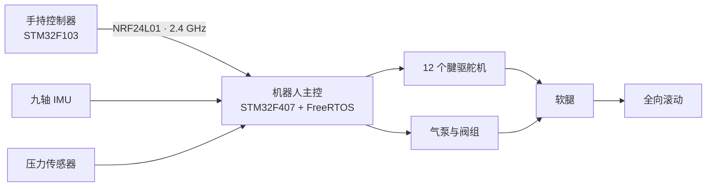

<div align="center">


# Rolling Robot

**一台通过改变自身形态实现滚动的无系留正十二面体软体机器人**

[English](README.md) · [简体中文](README.zh-CN.md)


</div>

---

机器人以正十二面体为主体，12 个面上各布置一条气动—腱驱耦合软腿。软腿按顺序收缩与伸展，把重心推出支撑区域，从而在不连接外部气管的情况下实现全向滚动。

华南理工大学机器人学院 · 本科毕业设计 · 作者：曾宇烽 · 指导教师：李云泉 教授

## 核心设计

- **全向滚动**：对称的正十二面体，12 个面均可驱动
- **气动—腱驱耦合软腿**：腱绳负责收缩，气压调节刚度并提供伸展力
- **三腿互联气路**：两腿收缩挤出的气体被伸展腿复用
- **分布式控制**：手持端 STM32F103 + 本体 STM32F407（FreeRTOS）
- **IMU 状态估计**：识别当前支撑顶点并决定下一步滚动方向

## 实验结果

| 指标 | 数值 |
| --- | --- |
| 峰值窗口速度（平地，15 kPa） | **0.267 m/s** |
| 全程平均速度（15 kPa） | 0.053 m/s |
| 负载能力 | 搭载 **1 kg** 连续滚动（速度下降 43%） |
| 地形 | 平地、碎石、草地 |
| 耦合 vs. 非耦合 | 腱绳张力降低约 34%，伸展力提升近 3 倍 |

<sub>以上数据仅对应原样机及其测试条件。</sub>

## 系统架构



机器人端 5 个 FreeRTOS 任务通过消息队列协作：

| 任务 | 源文件 | 作用 |
| --- | --- | --- |
| `wit_imu` | [`wit_imu.c`](firmware/robot/Task/Src/wit_imu.c) | 姿态、支撑顶点、方向与速度估计 |
| `nrf_recv` | [`nrf_recv.c`](firmware/robot/Task/Src/nrf_recv.c) | 接收遥控指令、更新设定值 |
| `charge_task` | [`pump_charge.c`](firmware/robot/Task/Src/pump_charge.c) | PID 辅助软 PWM 压力控制 |
| `move_task` | [`servo_move.c`](firmware/robot/Task/Src/servo_move.c) | 步态选择与舵机插值运动 |
| `nrf_send` | [`nrf_send.c`](firmware/robot/Task/Src/nrf_send.c) | 向手持端回传状态 |

## 仓库结构

```text
Rolling_Robot/
├── firmware/
│   ├── robot/        # STM32F407VET6 · Keil 工程、FreeRTOS 任务、驱动
│   ├── controller/   # STM32F103C8T6 · 带 OLED 的手持遥控器
│   └── prebuilt/     # 可直接烧录的 .hex
├── hardware/
│   └── cad/          # SolidWorks 零件与装配体、STL / 3MF
└── docs/assets/      # README 图片资源
```

## 快速上手

**直接烧录**：使用 STM32CubeProgrammer 或任意 ST-Link 工具：

| 文件 | 目标 |
| --- | --- |
| [`firmware/prebuilt/rolling-robot.hex`](firmware/prebuilt/rolling-robot.hex) | STM32F407VET6 机器人主控 |
| [`firmware/prebuilt/controller.hex`](firmware/prebuilt/controller.hex) | STM32F103C8T6 手持控制器 |

**从源码编译**：安装 Keil MDK-ARM 及 STM32F1/F4 芯片包，然后打开：

- 机器人本体：[`firmware/robot/MDK-ARM/RollingRobot.uvprojx`](firmware/robot/MDK-ARM/RollingRobot.uvprojx)
- 手持控制器：[`firmware/controller/MDK-ARM/Controller.uvprojx`](firmware/controller/MDK-ARM/Controller.uvprojx)

引脚分配见各工程的 `.ioc` 文件。仓库保留了 CubeMX 生成的 HAL/CMSIS 源码，无需重新生成即可打开工程。

更多说明：[固件说明](firmware/README.md) · [机械设计说明](hardware/README.md)

## 样机参数

| 参数 | 数值 |
| --- | --- |
| 主体 | 正十二面体，外接球半径 150 mm |
| 软腿 | 12 条气动—腱驱软腿，标称行程 75 mm |
| 机器人主控 | STM32F407VET6（Cortex-M4，168 MHz） |
| 手持控制器 | STM32F103C8T6（Cortex-M3） |
| 无线通信 | NRF24L01，2.4 GHz |
| 感知 | WIT 九轴 IMU、压力传感器 |
| 软件 | STM32 HAL + FreeRTOS |

## 项目边界

本项目是已归档的研究样机，并非开箱即用的套件。完整复现需要匹配的电子元件、气动元件、舵机标定和装配参数；目前暂未提供完整 BOM 和接线图。

## 致谢

气动—腱驱耦合思路参考了 Fu 等人关于无系留软体滚动机器人的研究（*IEEE Robotics and Automation Letters*，2024）。

## 许可

暂未添加开源许可证，版权归作者（曾宇烽）所有，复用前请先获得许可。
